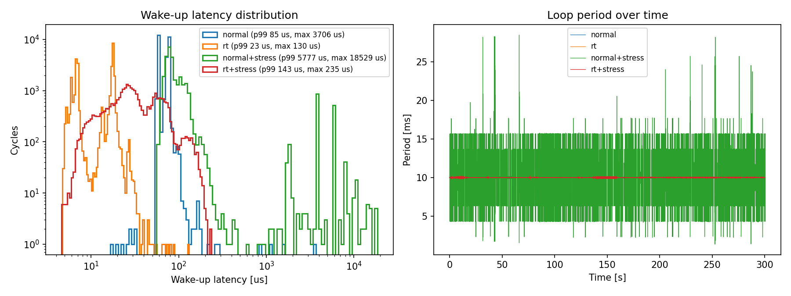
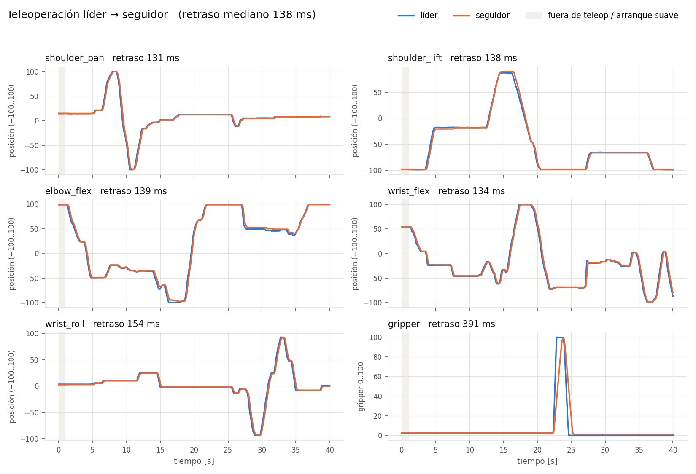
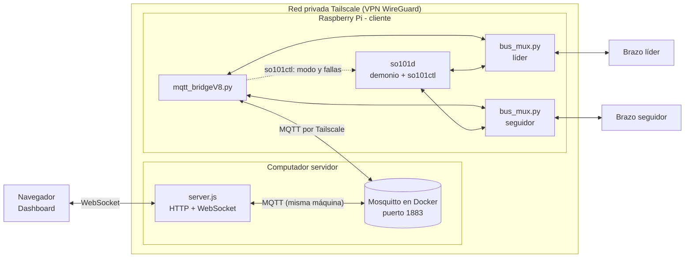
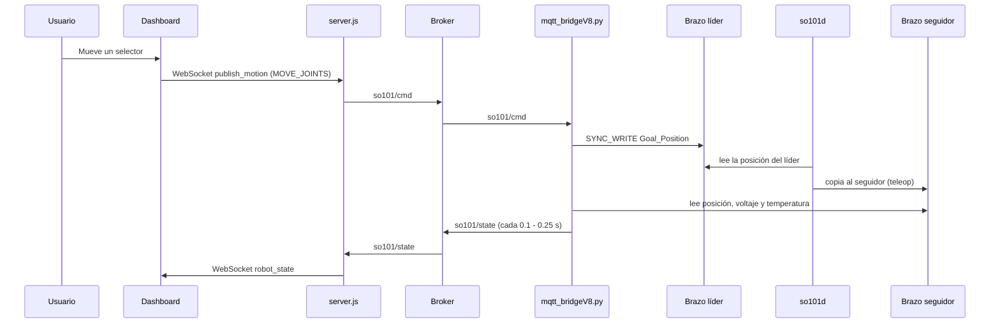

# SO-101 on a Raspberry Pi

Teleoperación líder→seguidor del brazo **SO-101** (servos Feetech STS3215) corriendo
en una **Raspberry Pi 4** con Linux embebido: driver propio en C, demonio de tiempo
real con supervisión de fallas, servicio systemd con watchdog y gemelo digital en
ROS 2 / RViz. Sin LeRobot en tiempo de ejecución (solo se reutiliza su calibración).

Proyecto final de **Sistemas Embebidos** — Pontificia Universidad Javeriana.

```
 Brazo líder ──USB──┐                         Raspberry Pi 4
                    │   ┌─────────────────────────────────────────────────┐
 Brazo seguidor ◄───┴──►│ so101d  (C, 100 Hz, SCHED_FIFO, systemd+watchdog)│
                        │   └─► /dev/shm/so101  (seqlock + buzón/semáforos)│
                        │          ├─► so101ctl / so101_log / so101.py     │
                        │          └─► so101_bridge (ROS 2 Jazzy, Docker)  │
                        └──────────────────────│──────────────────────────┘
                                   Zenoh / TCP 7447
                                               ▼
                               Mac → VM Ubuntu 24.04 → RViz (gemelo digital)
```

## Qué hay en el repo

| Carpeta | Qué es |
|---|---|
| [`driver/`](driver/) | Driver C (termios, 1 Mbps) del protocolo Feetech: PING/READ/WRITE/SYNC_READ/SYNC_WRITE, timeouts con `poll()`, resincronización y detección de eco. Herramienta de diagnóstico `fts_tool`, caracterización de jitter `jitter_test`, pruebas unitarias y bus simulado en pty (`sim/fake_bus.py`). |
| [`daemon/`](daemon/) | `so101d`: hilo de control a 100 Hz (SCHED_FIFO, `mlockall`, fijado a un núcleo), hilo supervisor a 50 Hz, memoria compartida POSIX con seqlock y buzón de comandos con dos semáforos con nombre. CLI `so101ctl`, logger `so101_log` y scripts de análisis. |
| [`daemon/systemd/`](daemon/systemd/) | Unidad `Type=notify` + `WatchdogSec=2`, usuario sin privilegios `so101` con `CAP_SYS_NICE`/`CAP_IPC_LOCK`, `ProtectSystem=strict`, IPC con permisos `0660`. `install.sh` idempotente. |
| [`clients/python/`](clients/python/) | `so101.py`: lee el estado y manda comandos desde Python (base para MQTT/dashboard). |
| [`ros2/`](ros2/) | `so101_bridge` (shm → `/joint_states` a 50 Hz, `/so101/cmd`) en Docker sobre la Pi y `so101_description` (URDF + RViz) en la VM. Transporte Zenoh por TCP para redes con NAT o sin multicast. |
| [`docs/`](docs/) | [`INTERFACE.md`](docs/INTERFACE.md) (contrato para clientes) y resultados medidos en [`docs/results/`]
| [`mqttBroker/`](mqttBroker/) | Broker MQTT (Mosquitto en Docker) del dashboard, en el mismo computador que el servidor. `compose.yaml` levanta el contenedor; `config/` contiene `mosquitto.conf`, `acl` (permisos por tópico) y `password.txt` (usuarios); `data/` guarda la persistencia y `log/` el log. Incluye `config/mock_raspberry.py`, un simulador de la Raspberry para probar el dashboard sin hardware. Escucha en el puerto 1883 y se accede por Tailscale. |
| [`RobotDashboard/`](RobotDashboard/) | Dashboard web de control remoto. `server.js` (Node.js) sirve la interfaz y hace de pasarela WebSocket ↔ MQTT; `src/` contiene `index.html`, `css/` y `js/` (`app.js` con la lógica y `arm3d.js` con los visores 3D); `test.js` es un script de pruebas. Incluye los modos de control Local / Dashboard, modelos 3D de la consigna y del brazo real, telemetría y consola de eventos. |
| [`raspi/`](raspi/) | Cliente MQTT de la Raspberry Pi: `mqtt_bridgeV8.py` (puente MQTT ↔ brazos; lee el modo y las fallas de `so101d` con `so101ctl`), `so101_bridge.ini` (broker, puertos y demonio), `so101_calibration.ini` (calibración líder/seguidor) y los scripts `inicializar_bus.sh` y `normalizacion.sh`, que automatizan los puertos seriales del demonio y del puente usando `bus_mux.py` . |(docs/results/2026-09-29/). |

## Funcionalidades del demonio

- **Modos:** `IDLE` (sin torque), `TELEOP`, `HOLD`, `ESTOP` (enclavado).
- **Seguridad al activar torque:** la meta inicial es la posición actual; nunca
  activa torque si no pudo leer el seguidor; **arranque suave por articulación**
  (~53 °/s) y luego límite de paso por ciclo (`-s`, 50 ticks).
- **Supervisor** con fallas enclavadas hasta `reset`:
  `STALL` (lazo detenido 200 ms → ESTOP), `LEADER_COMM` (→ HOLD),
  `FOLLOWER_COMM`, `OVERTEMP` (≥ 60 °C), `VOLTAGE` (fuera de 4.5–8.4 V) → IDLE,
  `OVERRUN` (aviso).
- **Robustez:** reconexión automática si se desconecta un USB; el watchdog de
  systemd solo se alimenta si el lazo **y** el supervisor avanzan, y al
  reiniciar el brazo queda sin torque.

## Resultados (hardware real, 29 sep 2026)

**SCHED_FIFO vs. planificador normal** (lazo con bus, 30 000 ciclos, `stress-ng` en paralelo):

| Latencia de despertar | p99 | p99.9 | máx |
|---|---|---|---|
| SCHED_OTHER + carga | 5.8 ms | 10.6 ms | 18.5 ms |
| **SCHED_FIFO + carga** | **143 µs** | **179 µs** | **235 µs** |

**so101d a 100 Hz** (10 min por escenario):

| Escenario | Despertar máx | Ejecución típica | Ejecución máx | Ciclos > 10 ms |
|---|---|---|---|---|
| Sin carga | 102 µs | 2.2 ms | 7.9 ms | 0 / 60 000 |
| Con `stress-ng` | 291 µs | 2.2 ms | 11.8 ms | 4 / 59 000 (0.007 %) |
| Teleop + `stress-ng` | 208 µs | 2.3 ms | 9.7 ms | 0 |

La cola de ejecución viene de las transacciones USB-serial (líder ~0.93 ms +
seguidor ~1.28 ms típicos), no del CPU.

**Retraso de teleoperación** (correlación cruzada, 40 s, `-s 50`): 131–154 ms en
las articulaciones (pinza 391 ms). El software aporta **0 ciclos** de retraso
medible (líder→meta); todo el retraso es meta→seguidor, es decir, el lazo interno
del STS3215. Con `-s 5` el límite de velocidad domina (655–848 ms).

<p align="center">
  
  
</p>

Gemelo digital en RViz verificado con la Pi en la red del campus, en cable
directo sin internet y en arranque en frío.

## Inicio rápido

Requisitos: Raspberry Pi OS de 64 bits, brazos calibrados con LeRobot
(`lerobot-calibrate`) y reglas udev que creen `/dev/so101_leader` y
`/dev/so101_follower`.

```sh
git clone https://github.com/davo260/SO101-on-a-RPI.git && cd SO101-on-a-RPI
make -C driver test && make -C daemon test      # pruebas sin hardware

cd daemon && sudo ./systemd/install.sh          # compila, instala y copia calibración a /etc/so101
sudo systemctl enable --now so101d
so101ctl watch                                  # estado en vivo
so101ctl teleop                                 # también: hold | idle | estop | reset
```

Gemelo digital: `./ros2/docker/run_bridge.sh` en la Pi y los pasos de
[`ros2/README.md`](ros2/README.md) en la VM.

**Sin hardware:** dos buses simulados con `driver/sim/fake_bus.py` y `so101d`
apuntando a los pty (ver [`daemon/README.md`](daemon/README.md#sin-hardware)).

## Siguientes pasos

- Pruebas de inyección de fallas documentadas (USB, estop, `kill -STOP`, reinicio con el puente reconectando).
- `threadirqs` + afinidad de la IRQ xhci al núcleo del lazo.
- Capa de red MQTT/dashboard sobre [`docs/INTERFACE.md`](docs/INTERFACE.md).
- MoveIt y cámara.


# SO101 · Control remoto del brazo robótico (Dashboard + Raspberry Pi + MQTT sobre Tailscale)

Sistema para operar y monitorizar un par de brazos robóticos **SO-101 (líder / seguidor)** desde un dashboard web, a través de internet y de forma segura.

- **Dashboard** (computador servidor): interfaz web con modelos 3D, control por articulación, telemetría y consola de eventos.
- **Cliente** (Raspberry Pi): puente MQTT, demonio de tiempo real `so101d` y multiplexor de buses seriales.
- **MQTT**: broker Mosquitto en Docker, en el mismo computador que el servidor del dashboard. Cliente y servidor se comunican por una **VPN Tailscale**.

## Contenido

1. [Dashboard](#1-dashboard)
2. [Cliente (Raspberry Pi)](#2-cliente-raspberry-pi)
3. [MQTT y arquitectura de comunicación](#3-mqtt-y-arquitectura-de-comunicación)
4. [Orden de arranque](#4-orden-de-arranque)
5. [Limitaciones conocidas](#5-limitaciones-conocidas)

---

## 1. Dashboard

### Ruta de los archivos

```
RobotDashboard/
├── server.js            # Servidor Node.js (HTTP + WebSocket + cliente MQTT)
├── package.json
└── src/
    ├── index.html       # Estructura de la interfaz
    ├── css/
    │   └── styles.css   # Estilos
    └── js/
        ├── arm3d.js     # Visores 3D del brazo (Three.js)
        └── app.js       # Lógica de la interfaz
```

### Resumen de los archivos

| Archivo | Qué contiene y qué hace |
|---|---|
| `server.js` | Servidor Node.js del dashboard. Sirve los archivos estáticos y mantiene un **WebSocket** con el navegador. Se conecta al broker MQTT en nombre de la interfaz: abre o cierra la conexión cuando el usuario pulsa *Conectar MQTT*, publica en `so101/cmd` lo que envía el navegador (`publish_motion`) y le reenvía el estado (`so101/state`), los eventos y los logs. |
| `index.html` | Estructura de la página: barra superior (estado MQTT, modo del demonio, fallas, selector de modo de control, Home y EMERGENCY STOP), barra de modos del demonio, seis tarjetas de articulación con selector y telemetría, dos visores 3D y la consola de eventos. Carga Three.js r128 y `OrbitControls` desde CDN, por lo que el navegador necesita acceso a internet. Incluye estilos propios para la barra de modos y el selector de control. |
| `styles.css` | Estilos de la interfaz: barra superior, tarjetas de articulación, píldoras de modo y fallas, botones, visores y consola de eventos. |
| `app.js` | Lógica del cliente. Gestiona el WebSocket, los **modos de control** (Local / Dashboard), los selectores, el envío de consignas en ráfaga, la conversión de valores normalizados (`Lnorm`) a ticks del líder (`Lraw`), la recepción del estado y las posiciones, el botón de emergencia y la consola de logs. |
| `arm3d.js` | Define `createArmViewer(contenedor, tipo)`, que crea un visor 3D con Three.js. Expone `setNormalizedPose(pose)` para mover el modelo con valores normalizados y `highlightJoint(articulación)` para resaltar la que se está moviendo. La interfaz crea dos visores: el de consigna / líder y el del brazo real (seguidor). |

### Funcionalidades

- **Seis articulaciones** controlables por selector: `shoulder_pan`, `shoulder_lift`, `elbow_flex`, `wrist_flex` y `wrist_roll` en el rango **−100…100**, y `gripper` en **0…100**.
- **Dos modelos 3D en tiempo real**:
  - *Consigna (Setpoint)*, que en Modo Local pasa a ser *Brazo Líder (posición actual)*.
  - *Brazo Real*, que sigue la telemetría del seguidor.
- **Telemetría por servo**: temperatura y voltaje.
- **Indicadores de sistema**: estado MQTT, modo de operación del demonio y lista de fallas.
- **Barra de modos del demonio**: `IDLE`, `HOLD`, `TELEOP`, `ESTOP`, `RESET`.
- **EMERGENCY STOP** con rearme, sincronizado con el estado real: se bloquea si el demonio o el puente están en parada.
- **Home Position**: lleva el líder a 0 (solo en Modo Dashboard, con confirmación).
- **Consola de eventos** MQTT y del sistema.
- Valores sin dato (`null`) se omiten en los modelos 3D para no romper la visualización.

### Modos de operación

El dashboard maneja **dos conceptos distintos**: el *modo de control* del líder y el *modo del demonio*.

#### A) Modo de control: Local / Dashboard

Se elige con el selector de la barra superior. El valor real lo decide el puente (`control_mode` en `so101/state`) y el dashboard lo refleja.

| | **Modo Local** (por defecto) | **Modo Dashboard** |
|---|---|---|
| Quién mueve el líder | El usuario, a mano | Los selectores del dashboard |
| Selectores | Bloqueados; siguen la posición real del líder | Activos |
| Consignas | **Bloqueadas** (en el dashboard y en el puente) | Enviadas en tiempo real (~16 Hz máx.), solo de la articulación movida |
| Modelo de consigna | Muestra el líder real | Muestra la consigna |
| Posiciones recibidas | Líder y seguidor | Líder y seguidor |
| Home | Deshabilitado | Habilitado (con confirmación) |

Detalles de comportamiento:

- En Modo Dashboard, mientras se arrastra un selector (y 0.8 s después) no se sobrescribe con la posición del líder; pasado ese tiempo muestra la posición real.
- Entrar a Modo Dashboard pide confirmación y solo se activa cuando el puente lo confirma. Volver a Local es inmediato.
- Un **ESTOP** (del dashboard o del demonio) devuelve el control a Local. Tras rearmar hay que elegir Modo Dashboard otra vez, de forma explícita.
- Con un líder real y `LEADER_TORQUE=1` en el puente, el torque del líder está activo solo en Modo Dashboard.

#### B) Modo del demonio (`so101d`)

Se muestra en la píldora *MODO* y se cambia con la barra de modos. Es el modo real del demonio, que el puente lee con `so101ctl status`.

| Modo | Significado |
|---|---|
| `idle` | Reposo. Es el modo de arranque seguro del demonio. |
| `teleop` | Teleoperación: el seguidor copia al líder. Pide confirmación al activarlo desde el dashboard. |
| `hold` | Mantiene la posición. |
| `estop` | Parada de emergencia del demonio. |
| `reset` | Limpia fallas y rearma. |

### Protocolo WebSocket (navegador ↔ `server.js`)

| Sentido | Mensaje | Uso |
|---|---|---|
| Navegador → servidor | `mqtt_connect`, `mqtt_disconnect` | Abrir / cerrar la conexión MQTT |
| Navegador → servidor | `publish_motion` `{ payload }` | Publicar `payload` en `so101/cmd` |
| Servidor → navegador | `mqtt_status_change` `{ status }` | `connected`, `connecting`, `disconnected`, `error` |
| Servidor → navegador | `robot_state` `{ data }` | Contenido de `so101/state` |
| Servidor → navegador | `log_event` `{ level, message, detail, timestamp }` | Mensajes para la consola |

### Ejecución

```bash
cd RobotDashboard
npm install
node server.js
```

Abre el dashboard en el navegador (`http://<IP-del-servidor>:<PUERTO>`). Configura en `server.js` la conexión al broker: host, puerto 1883 y el usuario `dashboard` con su contraseña.

---

## 2. Cliente (Raspberry Pi)

### Ruta de los archivos

```
SO101-on-a-RPI/
├── daemon/                  # so101d (demonio de tiempo real) y so101ctl
└── driver/
    └── bridge/
        ├── mqtt_bridgeV8.py       # Puente MQTT <-> brazos
        ├── so101_bridge.ini       # Configuración general (MQTT, puertos, demonio)
        ├── so101_calibration.ini  # Calibración de articulaciones
        ├── bus_mux.py             # Multiplexor de buses seriales
        ├── inicializar_bus.sh     # Automatiza los puertos (simulación)
        ├── normalizacion.sh       # Restaura los puertos físicos
        └── resumen.txt            # (generado) resumen de los puertos
```

### Resumen de los archivos

| Archivo | Qué contiene y qué hace |
|---|---|
| `mqtt_bridgeV8.py` | Puente MQTT. Recibe órdenes en `so101/cmd` y las ejecuta; publica el estado, los eventos y los resultados. Ver detalle abajo. |
| `so101_bridge.ini` | Configuración general: broker MQTT, puertos seriales, periodo de publicación y opciones del demonio. |
| `so101_calibration.ini` | Rangos de calibración (normalizado ↔ ticks) del líder y del seguidor. |
| `bus_mux.py` | Proxy que permite que el demonio y el puente compartan un mismo bus serial. |
| `inicializar_bus.sh` | Arranca los dos `bus_mux`, detecta los puertos virtuales que crean, actualiza el `.ini` y crea los enlaces que usa el demonio. |
| `normalizacion.sh` | Restaura `/dev/so101_leader` y `/dev/so101_follower` apuntando a los puertos físicos. |

### `mqtt_bridgeV8.py`

Es el único proceso del cliente que habla MQTT. Hace lo siguiente:

1. **Escribe las consignas en el líder** (`SYNC_WRITE` a `Goal_Position`) cuando llega un `MOVE_JOINTS`. Nunca escribe en el seguidor: la copia líder → seguidor la hace el demonio en modo `teleop`.
2. **Lee el seguidor y el líder** (posición, voltaje, temperatura y corriente) y los convierte a valores normalizados con `so101_calibration.ini`.
3. **Se integra con el demonio** mediante `so101ctl`:
   - Lee el modo real y las fallas con `so101ctl status`.
   - Con `DAEMON_CONTROL = 1`, ejecuta `so101ctl idle | hold | teleop | estop | reset` cuando el dashboard lo pide.
4. **Gestiona el modo de control** Local / Dashboard. Arranca siempre en **Local** y rechaza `MOVE_JOINTS` mientras no esté en Dashboard.
5. **Publica** `so101/state`, `so101/event` y `so101/cmd/result`, y deja un *Last Will* (`OFFLINE`) por si la Raspberry se cae sin avisar.

Uso:

```bash
python3 mqtt_bridgeV8.py                      # usa so101_bridge.ini y so101_calibration.ini del mismo directorio
python3 mqtt_bridgeV8.py -c otra.ini --calib otra_calibracion.ini
LEADER_TORQUE=1 python3 mqtt_bridgeV8.py      # solo con un líder real (torque ON en Modo Dashboard)
```

Las rutas también se pueden dar con `SO101_BRIDGE_INI` y `SO101_CALIB_INI`. Cualquier clave del `.ini` se puede sobrescribir con una variable de entorno del mismo nombre.

### `so101_bridge.ini`

> Contiene la contraseña de MQTT: protégelo con `chmod 600 so101_bridge.ini` y **no lo subas a Git** (añádelo a `.gitignore` y publica solo una copia de ejemplo).

```ini
[mqtt]
# IP (o nombre) del servidor donde corre Mosquitto: la IP de Tailscale del servidor
MQTT_BROKER = 100.x.y.z
MQTT_PORT = 1883
MQTT_USER = raspberry
MQTT_PASSWORD = CAMBIA_ESTA_CLAVE
# Periodo de publicación de so101/state. 0.25 = 4 Hz; 0.1 = 10 Hz (recomendado para seguimiento en tiempo real)
STATE_PERIOD_S = 0.1

[serial]
# Puertos del puente (los escribe inicializar_bus.sh)
LEADER_PORT = /tmp/so101_leader_bridge
FOLLOWER_PORT = /tmp/so101_follower_bridge
BAUDRATE = 1000000
# Leer también la posición del líder (necesario para que el dashboard la muestre)
READ_LEADER = 1

[daemon]
# ctl = modo y fallas reales con "so101ctl status" | cmd = solo pruebas sin demonio | none
MODE_SOURCE = ctl
SO101CTL = so101ctl
# Cada cuántos segundos se consulta al demonio
DAEMON_POLL_S = 0.5
# 1 = el dashboard puede cambiar el modo del demonio (so101ctl idle/hold/teleop/estop/reset)
DAEMON_CONTROL = 1
```

### `so101_calibration.ini`

Define, por articulación, cómo se convierten los valores normalizados (`Lnorm`) a ticks del servo (`Lraw`, 0–4095). Cada línea tiene el formato `articulación = LnormMin, LrawMin, LnormMax, LrawMax`.

```ini
[leader_calibration]
shoulder_pan  = -100, 729, 100, 4000
shoulder_lift = -100, 1822, 100, 3323
elbow_flex    = -100, 824, 100, 3051
wrist_flex    = -100, 837, 100, 3213
wrist_roll    = -100, 0, 100, 4095
gripper       = 0, 2040, 100, 3400

[follower_calibration]
shoulder_pan  = -100, 700, 100, 3900
shoulder_lift = -100, 760, 100, 2350
elbow_flex    = -100, 923, 100, 3051
wrist_flex    = -100, 850, 100, 2700
wrist_roll    = -100, 0, 100, 4095
gripper       = 0, 1601, 100, 3100
```

> Los valores de arriba son los que trae el puente por defecto si no encuentra el archivo; usa los de tu calibración real.

> **Coherencia de calibración.** La calibración del líder existe en tres sitios: este archivo, la tabla `CALIBRATION` de `public/js/app.js` y los JSON del demonio (`/etc/so101/*.json`). Deben coincidir. Si no, al tocar un selector justo después de entrar a Modo Dashboard, el líder dará un salto igual a la diferencia.

### `bus_mux.py` y por qué es importante

El demonio `so101d` abre los puertos seriales de los brazos **en exclusiva**. Mientras esté en marcha, ningún otro proceso puede abrirlos: el puente falla con `Errno 16 (Device or resource busy)` y no puede escribir consignas ni leer el estado.

`bus_mux.py` resuelve esto colocándose entre el bus y sus dos clientes:

```
 Bus (brazo)  <───>  bus_mux.py  <───>  /tmp/so101_<brazo>_daemon  → so101d
                                 <───>  /tmp/so101_<brazo>_bridge  → mqtt_bridgeV8.py
```

- Es el **único** proceso que abre el bus real y crea dos puertos virtuales (pty) por brazo, con enlaces estables en `/tmp`.
- **Arbitra el acceso**: envía una petición cada vez y devuelve la respuesta solo al cliente que la hizo. El demonio tiene prioridad sobre el puente.
- Las instrucciones sin respuesta (`SYNC_WRITE`, difusión) no esperan al bus.
- Se lanza una instancia por brazo.

```bash
python3 bus_mux.py --arm leader   --bus /dev/pts/4
python3 bus_mux.py --arm follower --bus /dev/pts/5
# opciones: --timeout MS (por defecto 30)   --stats (resumen por segundo)
```

Al salir con Ctrl+C imprime un resumen con las peticiones y los timeouts de cada cliente. Un proxy en Python añade latencia: si el demonio da timeouts, arranca `so101d` con `-t 10` (o más) y baja `-R`.

### `inicializar_bus.sh`

Automatiza el arranque de los puertos para el demonio y el puente. Está configurado para **buses simulados** (`/dev/pts/N`, creados por `sim/fake_bus.py`).

1. Valida que no se ejecuta como root y que existen `bus_mux.py`, `so101_bridge.ini` y los dos buses.
2. Inicia `bus_mux.py` para el **líder** y espera a que imprima sus puertos (`bridge` y `daemon`).
3. Hace lo mismo con el **seguidor**.
4. Actualiza `LEADER_PORT` y `FOLLOWER_PORT` en `so101_bridge.ini` con los puertos del puente.
5. Crea los enlaces `/dev/so101_leader` y `/dev/so101_follower`, que apuntan a los puertos del demonio, y les da permisos (`chmod 666`).
6. Genera `resumen.txt` y deja los dos `bus_mux` en marcha. **Ctrl+C** detiene ambos.

`/dev/so101_leader` y `/dev/so101_follower` son los puertos que `so101d` usa por defecto, así que el demonio los toma sin indicar rutas.

```bash
chmod +x inicializar_bus.sh
./inicializar_bus.sh        # sin sudo: el propio script usa sudo solo para los enlaces y los permisos
```

Antes de ejecutarlo, edita al principio del script `LEADER_BUS` y `FOLLOWER_BUS` con los puertos que imprimieron los dos `fake_bus.py`, porque cambian en cada arranque. Ejecútalo desde la carpeta donde están `bus_mux.py` y `so101_bridge.ini`.

### `normalizacion.sh`

Restaura la configuración **directa** de puertos físicos: apunta `/dev/so101_leader` a `/dev/ttyACM0` y `/dev/so101_follower` a `/dev/ttyACM1`, y muestra los enlaces resultantes. Úsalo al terminar una sesión con el simulador, o para ejecutar el demonio sobre los brazos reales sin el multiplexor.

```bash
chmod +x normalizacion.sh
./normalizacion.sh
```

- Detén antes el demonio y los `bus_mux`.
- Sin el multiplexor, el puente no puede abrir esos puertos mientras el demonio esté en marcha.
- La asignación `ttyACM0` / `ttyACM1` puede intercambiarse entre arranques: si el líder y el seguidor se cruzan, fija los nombres con reglas `udev` por número de serie.

---

## 3. MQTT y arquitectura de comunicación

### Arquitectura

- **Broker**: Mosquitto en un contenedor Docker, en el **mismo computador que el servidor del dashboard**.
- **Servidor del dashboard** (`server.js`): se conecta al broker como cliente (usuario `dashboard`) y hace de pasarela entre el navegador (WebSocket) y MQTT.
- **Cliente** (Raspberry Pi): `mqtt_bridgeV8.py` se conecta al broker como cliente (usuario `raspberry`).
- **Comunicación remota**: servidor y Raspberry están en la misma red privada **Tailscale**, así que el cliente llega al broker por la IP de Tailscale del servidor, aunque estén en redes domésticas o universitarias distintas.



Flujo de una consigna en Modo Dashboard:



### Tópicos

| Tópico | Publica | Se suscribe | Frecuencia | QoS del puente | Contenido |
|---|---|---|---|---|---|
| `so101/cmd` | Dashboard (`server.js`) | Puente | Por acción del usuario. En Modo Dashboard, `MOVE_JOINTS` en ráfaga: máx. ~16 Hz (cada 60 ms) mientras se mueve un selector | — | Órdenes: `MOVE_JOINTS`, `SET_CONTROL`, `SET_MODE`, `EMERGENCY_STOP`, `RESET_ESTOP` |
| `so101/state` | Puente | Dashboard | Periódica: cada `STATE_PERIOD_S` (0.25 s por defecto = 4 Hz; 0.1 s = 10 Hz) | 0 | Estado completo del sistema |
| `so101/event` | Puente | Dashboard | Solo ante un evento | 1 | `ONLINE`, `OFFLINE`, `MODE_CHANGED`, `CONTROL_CHANGED`, `FAULT_TRIGGERED`, `FAULT_CLEARED` |
| `so101/cmd/result` | Puente | Dashboard | Una respuesta por comando (los `MOVE_JOINTS` en ráfaga solo responden si fallan) | 1 | `status` y `detail` |

Ningún mensaje se publica como *retained*. El puente consulta además al demonio con `so101ctl status` cada `DAEMON_POLL_S` (0.5 s por defecto); esa comunicación es local y no pasa por MQTT.

### Formato de los mensajes

**`so101/state`** (puente → dashboard)

```json
{
  "timestamp": 1730000000000,
  "mode": "teleop",
  "mode_source": "daemon",
  "control_mode": "local",
  "faults": [],
  "position":        { "shoulder_pan": 12.4, "shoulder_lift": -30.6, "elbow_flex": 50.0,
                       "wrist_flex": 0.0, "wrist_roll": -80.0, "gripper": 75.0 },
  "leader_position": { "shoulder_pan": 12.1, "shoulder_lift": -30.2, "elbow_flex": 49.8,
                       "wrist_flex": 0.0, "wrist_roll": -80.0, "gripper": 75.0 },
  "telemetry": { "shoulder_pan": { "temp": 31.0, "volt": 12.1, "curr": 0.15 } },
  "daemon": { "online": true, "ramping": false, "torque": true,
              "leader_ok": true, "follower_ok": true }
}
```

- `position`: seguidor, normalizado. `leader_position`: líder, normalizado.
- `mode`: modo real del demonio (`idle | hold | teleop | estop | reset`), o `unknown` si no responde.
- `control_mode`: `local` o `dashboard`.
- `faults`: fallas del demonio (`LEADER_COMM`, `FOLLOWER_COMM`, `OVERTEMP`, `VOLTAGE`, `OVERRUN`, `STALL`, `ESTOP`, `TORQUE_REFUSED`) y del puente (`BUS_TIMEOUT:<articulación>`, `DAEMON_OFFLINE`, `EMERGENCY_STOP_TRIGGERED`).
- Un valor `null` significa que no hay dato real (nunca se inventa). `curr` está en amperios.

**`so101/cmd`** (dashboard → puente)

| Comando | Ejemplo | Efecto |
|---|---|---|
| `MOVE_JOINTS` | `{"command":"MOVE_JOINTS","stream":true,"target_position":{"elbow_flex":20},"target_raw":{"elbow_flex":2100}}` | Escribe la consigna en el líder. Solo en Modo Dashboard y fuera de estop. Si trae `target_raw` (ticks) lo usa; si no, convierte `target_position` con la calibración del líder |
| `SET_CONTROL` | `{"command":"SET_CONTROL","control":"dashboard"}` | Cambia el modo de control (`local` o `dashboard`) |
| `SET_MODE` | `{"command":"SET_MODE","mode":"teleop"}` | Ejecuta `so101ctl <modo>` en la Raspberry (requiere `DAEMON_CONTROL = 1`) |
| `EMERGENCY_STOP` | `{"command":"EMERGENCY_STOP"}` | Bloquea las consignas, devuelve el control a Local y ejecuta `so101ctl estop` |
| `RESET_ESTOP` | `{"command":"RESET_ESTOP"}` | Ejecuta `so101ctl reset`; si el demonio lo rechaza, la parada se mantiene |

**`so101/cmd/result`** (puente → dashboard)

```json
{ "status": "OK", "detail": "so101ctl teleop: OK" }
```

`status` puede ser `OK`, `BAD_CMD`, `REJECTED`, `BUS_ERROR` o `DAEMON_ERROR`.

**`so101/event`** (puente → dashboard)

```json
{ "event": "MODE_CHANGED",    "from": "idle", "to": "teleop", "source": "daemon", "timestamp": 1730000000.1 }
{ "event": "CONTROL_CHANGED", "from": "local", "to": "dashboard", "source": "dashboard", "timestamp": 1730000000.2 }
{ "event": "FAULT_TRIGGERED", "fault": "OVERTEMP", "source": "daemon", "timestamp": 1730000000.3 }
```

### Broker Mosquitto (Docker)

`mosquitto.conf`:

```conf
# Listener MQTT
listener 1883 0.0.0.0

# Autenticacion
allow_anonymous false
password_file /mosquitto/config/password.txt
acl_file /mosquitto/config/acl

# Persistencia
persistence true
persistence_location /mosquitto/data/

# Logs
log_dest file /mosquitto/log/mosquitto.log

# Nivel de mensajes
log_type error
log_type warning
log_type notice
log_type information
```

- `listener 1883 0.0.0.0`: escucha MQTT en el puerto 1883 en todas las interfaces del contenedor.
- `allow_anonymous false`, `password_file` y `acl_file`: solo entran usuarios con clave, y cada uno con permisos limitados por tópico.
- `persistence`: guarda el estado del broker en `/mosquitto/data/`.
- `log_dest` / `log_type`: escribe en `/mosquitto/log/mosquitto.log` los niveles error, warning, notice e information.

Ejemplo de `docker-compose.yml`:

```yaml
services:
  mosquitto:
    image: eclipse-mosquitto:2
    container_name: mosquitto
    restart: unless-stopped
    ports:
      - "127.0.0.1:1883:1883"      # el propio servidor (server.js)
      - "100.x.y.z:1883:1883"      # IP de Tailscale del servidor (la Raspberry)
    volumes:
      - ./mosquitto/config:/mosquitto/config   # mosquitto.conf, password.txt, acl
      - ./mosquitto/data:/mosquitto/data
      - ./mosquitto/log:/mosquitto/log
```

Publicar el puerto solo en `127.0.0.1` y en la IP de Tailscale evita exponerlo en la red local o en internet.

Usuarios y permisos:

```bash
docker exec -it mosquitto mosquitto_passwd -c /mosquitto/config/password.txt raspberry
docker exec -it mosquitto mosquitto_passwd    /mosquitto/config/password.txt dashboard
docker restart mosquitto
```

`/mosquitto/config/acl`:

```
user raspberry
topic read  so101/cmd
topic write so101/state
topic write so101/event
topic write so101/cmd/result

user dashboard
topic write so101/cmd
topic read  so101/state
topic read  so101/event
topic read  so101/cmd/result
```

Así, quien consiga la clave del dashboard no puede hacerse pasar por la Raspberry, y al revés.

### Comunicación remota con Tailscale (VPN)

[Tailscale](https://tailscale.com) crea una red privada cifrada (basada en WireGuard) entre los equipos de una misma cuenta. Cada uno recibe una IP `100.x.y.z` estable.

1. Instala Tailscale en el **computador servidor** y en la **Raspberry Pi**, e inicia sesión con la misma cuenta.
2. En la consola de administración, desactiva la caducidad de llave (*Disable key expiry*) en ambos equipos para que no se desconecten con el tiempo.
3. Obtén la IP de Tailscale del servidor (`tailscale ip -4`) y úsala como `MQTT_BROKER` en `so101_bridge.ini`.
4. Comprueba la conexión: `tailscale ping <IP-del-servidor>` desde la Raspberry.

Por qué se usa:

- **Seguridad**: el tráfico MQTT viaja dentro del túnel cifrado. El puerto 1883 es MQTT sin TLS, y el cifrado lo aporta la VPN; no se abre ningún puerto del router a internet.
- **Conectividad**: la Raspberry y el servidor inician la conexión hacia fuera, así que funciona detrás de redes domésticas o universitarias que no permiten conexiones entrantes. Si no hay camino directo, Tailscale usa servidores de relevo.
- **Latencia**: por internet suele ser de decenas o cientos de milisegundos. Es adecuada para consignas de posición, pero no para teleoperación fina en tiempo real.

---

## 4. Orden de arranque

**Computador servidor**

1. `docker compose up -d` → broker Mosquitto.
2. `node server.js` → servidor del dashboard. Abre el dashboard en el navegador y pulsa *Conectar MQTT*.

**Raspberry Pi (con buses simulados)**

3. Dos instancias de `sim/fake_bus.py`, una para el líder y otra para el seguidor. Anota sus puertos y ponlos en `LEADER_BUS` y `FOLLOWER_BUS` de `inicializar_bus.sh`.
4. `./inicializar_bus.sh` → arranca los multiplexores, actualiza el `.ini` y crea `/dev/so101_leader` y `/dev/so101_follower`.
5. Demonio:
   ```bash
   /usr/local/bin/so101d -L /etc/so101/so101_leader.json -F /etc/so101/so101_follower.json -m idle -t 10
   ```
6. Puente: `python3 mqtt_bridgeV8.py`.

Para volver a la configuración con puertos físicos, detén todo y ejecuta `./normalizacion.sh`.

---

## 5. Limitaciones conocidas

- `bus_mux.py` se desarrolló y se probó contra el simulador (`fake_bus.py`, puertos pty). Para un puerto serie real no configura la velocidad (1 Mbaud), así que con adaptadores USB-serie que dependan del baudrate habría que añadirla.
- El multiplexor, al ser un proxy en Python, añade latencia. Ajusta `-t` y `-R` del demonio si aparecen timeouts.
- `inicializar_bus.sh` tiene los puertos de los buses simulados escritos a mano en el script.
- La calibración del líder debe mantenerse sincronizada entre `so101_calibration.ini`, `app.js` y los JSON del demonio.
- El puente lee el líder por serie; si otro proceso lo mantiene en exclusiva, la posición del líder no llegará al dashboard.
