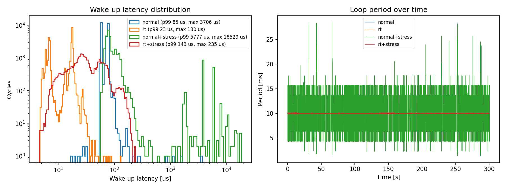
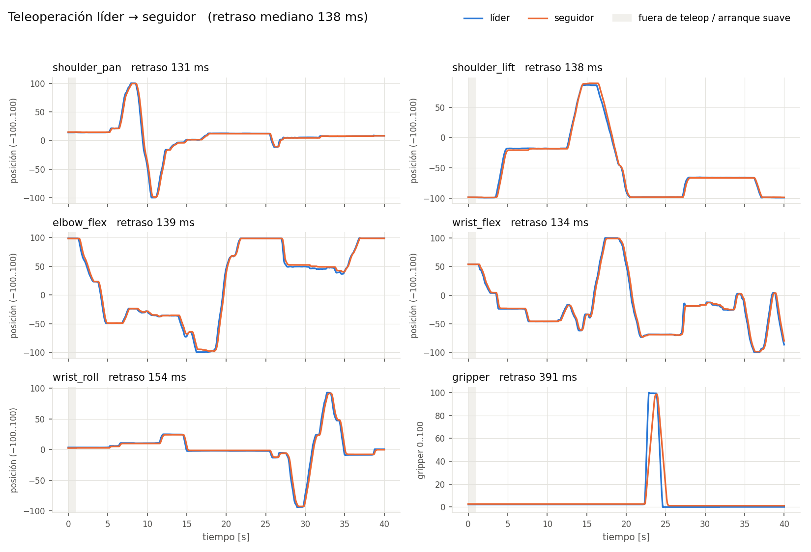

# SO-101 on a Raspberry Pi

Teleoperación líder→seguidor del brazo **SO-101** (servos Feetech STS3215) corriendo
en una **Raspberry Pi 4** con Linux embebido: driver propio en C, demonio de tiempo
real con supervisión de fallas, servicio systemd con watchdog y gemelo digital en
ROS 2 / RViz. Sin LeRobot en tiempo de ejecución (solo se reutiliza su calibración).

Proyecto final de **Sistemas Embebidos** — Pontificia Universidad Javeriana.

```
 Brazo líder ──USB──┐                         Raspberry Pi 4
                    │   ┌─────────────────────────────────────────────────┐
 Brazo seguidor ◄───┴──►│ so101d  (C, 100 Hz, SCHED_FIFO, systemd+watchdog)│
                        │   └─► /dev/shm/so101  (seqlock + buzón/semáforos)│
                        │          ├─► so101ctl / so101_log / so101.py     │
                        │          └─► so101_bridge (ROS 2 Jazzy, Docker)  │
                        └──────────────────────│──────────────────────────┘
                                   Zenoh / TCP 7447
                                               ▼
                               Mac → VM Ubuntu 24.04 → RViz (gemelo digital)
```

## Qué hay en el repo

| Carpeta | Qué es |
|---|---|
| [`driver/`](driver/) | Driver C (termios, 1 Mbps) del protocolo Feetech: PING/READ/WRITE/SYNC_READ/SYNC_WRITE, timeouts con `poll()`, resincronización y detección de eco. Herramienta de diagnóstico `fts_tool`, caracterización de jitter `jitter_test`, pruebas unitarias y bus simulado en pty (`sim/fake_bus.py`). |
| [`daemon/`](daemon/) | `so101d`: hilo de control a 100 Hz (SCHED_FIFO, `mlockall`, fijado a un núcleo), hilo supervisor a 50 Hz, memoria compartida POSIX con seqlock y buzón de comandos con dos semáforos con nombre. CLI `so101ctl`, logger `so101_log` y scripts de análisis. |
| [`daemon/systemd/`](daemon/systemd/) | Unidad `Type=notify` + `WatchdogSec=2`, usuario sin privilegios `so101` con `CAP_SYS_NICE`/`CAP_IPC_LOCK`, `ProtectSystem=strict`, IPC con permisos `0660`. `install.sh` idempotente. |
| [`clients/python/`](clients/python/) | `so101.py`: lee el estado y manda comandos desde Python (base para MQTT/dashboard). |
| [`ros2/`](ros2/) | `so101_bridge` (shm → `/joint_states` a 50 Hz, `/so101/cmd`) en Docker sobre la Pi y `so101_description` (URDF + RViz) en la VM. Transporte Zenoh por TCP para redes con NAT o sin multicast. |
| [`docs/`](docs/) | [`INTERFACE.md`](docs/INTERFACE.md) (contrato para clientes) y resultados medidos en [`docs/results/`](docs/results/2026-09-29/). |

## Funcionalidades del demonio

- **Modos:** `IDLE` (sin torque), `TELEOP`, `HOLD`, `ESTOP` (enclavado).
- **Seguridad al activar torque:** la meta inicial es la posición actual; nunca
  activa torque si no pudo leer el seguidor; **arranque suave por articulación**
  (~53 °/s) y luego límite de paso por ciclo (`-s`, 50 ticks).
- **Supervisor** con fallas enclavadas hasta `reset`:
  `STALL` (lazo detenido 200 ms → ESTOP), `LEADER_COMM` (→ HOLD),
  `FOLLOWER_COMM`, `OVERTEMP` (≥ 60 °C), `VOLTAGE` (fuera de 4.5–8.4 V) → IDLE,
  `OVERRUN` (aviso).
- **Robustez:** reconexión automática si se desconecta un USB; el watchdog de
  systemd solo se alimenta si el lazo **y** el supervisor avanzan, y al
  reiniciar el brazo queda sin torque.

## Resultados (hardware real, 29 sep 2026)

**SCHED_FIFO vs. planificador normal** (lazo con bus, 30 000 ciclos, `stress-ng` en paralelo):

| Latencia de despertar | p99 | p99.9 | máx |
|---|---|---|---|
| SCHED_OTHER + carga | 5.8 ms | 10.6 ms | 18.5 ms |
| **SCHED_FIFO + carga** | **143 µs** | **179 µs** | **235 µs** |

**so101d a 100 Hz** (10 min por escenario):

| Escenario | Despertar máx | Ejecución típica | Ejecución máx | Ciclos > 10 ms |
|---|---|---|---|---|
| Sin carga | 102 µs | 2.2 ms | 7.9 ms | 0 / 60 000 |
| Con `stress-ng` | 291 µs | 2.2 ms | 11.8 ms | 4 / 59 000 (0.007 %) |
| Teleop + `stress-ng` | 208 µs | 2.3 ms | 9.7 ms | 0 |

La cola de ejecución viene de las transacciones USB-serial (líder ~0.93 ms +
seguidor ~1.28 ms típicos), no del CPU.

**Retraso de teleoperación** (correlación cruzada, 40 s, `-s 50`): 131–154 ms en
las articulaciones (pinza 391 ms). El software aporta **0 ciclos** de retraso
medible (líder→meta); todo el retraso es meta→seguidor, es decir, el lazo interno
del STS3215. Con `-s 5` el límite de velocidad domina (655–848 ms).

<p align="center">
  
  
</p>

Gemelo digital en RViz verificado con la Pi en la red del campus, en cable
directo sin internet y en arranque en frío.

## Inicio rápido

Requisitos: Raspberry Pi OS de 64 bits, brazos calibrados con LeRobot
(`lerobot-calibrate`) y reglas udev que creen `/dev/so101_leader` y
`/dev/so101_follower`.

```sh
git clone https://github.com/davo260/SO101-on-a-RPI.git && cd SO101-on-a-RPI
make -C driver test && make -C daemon test      # pruebas sin hardware

cd daemon && sudo ./systemd/install.sh          # compila, instala y copia calibración a /etc/so101
sudo systemctl enable --now so101d
so101ctl watch                                  # estado en vivo
so101ctl teleop                                 # también: hold | idle | estop | reset
```

Gemelo digital: `./ros2/docker/run_bridge.sh` en la Pi y los pasos de
[`ros2/README.md`](ros2/README.md) en la VM.

**Sin hardware:** dos buses simulados con `driver/sim/fake_bus.py` y `so101d`
apuntando a los pty (ver [`daemon/README.md`](daemon/README.md#sin-hardware)).

## Siguientes pasos

- Pruebas de inyección de fallas documentadas (USB, estop, `kill -STOP`, reinicio con el puente reconectando).
- `threadirqs` + afinidad de la IRQ xhci al núcleo del lazo.
- Capa de red MQTT/dashboard sobre [`docs/INTERFACE.md`](docs/INTERFACE.md).
- MoveIt y cámara.
